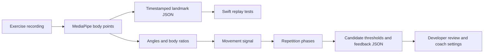

# Pipeline design

## Purpose and data flow

To develop exercise feedback, recorded movement must become measurements that can be compared across repetitions. The pipeline uses MediaPipe to estimate body points, then separates geometric measurement from signal analysis and coaching settings. This separation lets a developer inspect each stage when a movement is counted incorrectly or receives the wrong feedback.

## Modules and interfaces

| Module | Input | Responsibility and output |
| --- | --- | --- |
| `extract_poses.py` | Video path and requested sampling rate | Writes 21 named landmarks, visibility, timestamps, missing-pose records, and video metadata for replay |
| `src/video_processor.py` | Video and extraction settings | Produces detected `PoseFrame` objects using the types in `src/pose_frame.py` |
| `src/metric_calculator.py` | Pose frames | Produces `FrameMetrics`: joint angles, depth, symmetry, and body ratios |
| `src/signal_analyzer.py` | Metric time series | Ranks movement signals using variation, periodicity, and exercise-specific preferences |
| `src/rep_segmenter.py` | Selected signal and metric timestamps | Identifies top and bottom phases and groups measurements into candidate repetitions |
| `src/threshold_learner.py` | Repetition measurements | Estimates settings using percentiles and heuristic margins |
| `src/feedback_generator.py`, `src/json_exporter.py` | Settings and exercise metadata | Produce feedback templates and structured JSON |
| `learn_exercise.py` | Command-line options | Coordinates the threshold workflow and writes its output |
| `analyze_rep_calibration.py` | Historical labeled JSONL records | Summarizes counts and measurement distributions for calibration |

The replay exporter and threshold learner have separate extraction paths. The exporter uses the heavy pose configuration and preserves no-pose frames. The threshold workflow uses model complexity 1 and processes detected poses. The diagram describes their shared purpose; they do not call an identical extraction function.

## Timing and normalization

Timestamps follow the source video. Sampling uses an integer frame stride, and metadata records the requested and effective rates. For example, requesting 10 fps from a 25-fps recording selects every second frame, producing 12.5 fps. Segmentation matches measurements to timestamps after missing detections, which preserves alignment when frame indices have gaps.

The metric calculator expresses hand spacing relative to shoulder width. This helps account for body size and camera distance. Joint geometry otherwise uses normalized image coordinates. In the separate app implementation, head movement is normalized by torso length.

## Errors and outputs

The exporter validates sampling rates, represents missing detections explicitly, and releases video and model resources. The synthetic checks exercise these cases and confirm that threshold output can be serialized as finite JSON. Developers inspect the selected signal and proposed thresholds before using them in a coach.

The [requirements table](REQUIREMENTS.md) maps expected behavior to code and checks. [Integration](INTEGRATION.md) documents the Swift interface, and [validation](VALIDATION.md) records the executed checks and operating limits.
